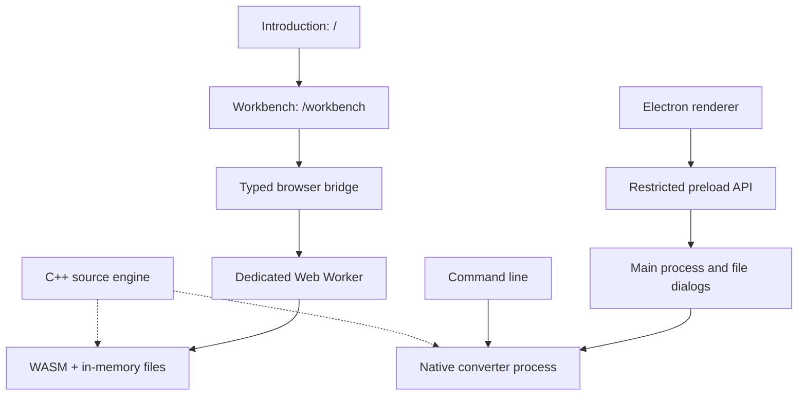
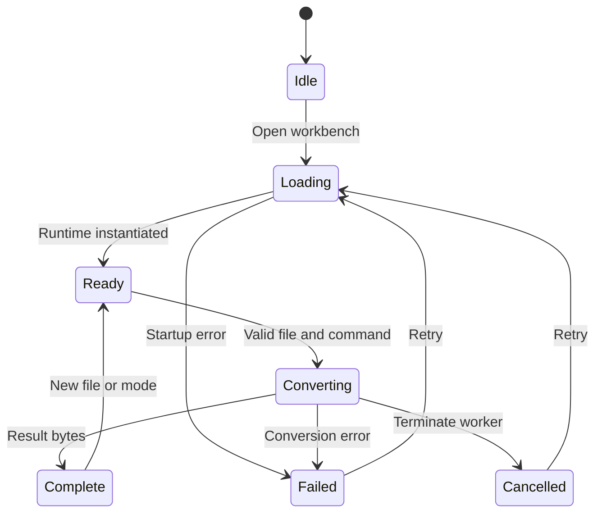

# Architecture and repository map

pka2xml keeps one conversion engine and three ways to use it. The introduction page explains the tool; the workbench owns interactive state. A browser tab never needs access to the host filesystem.

## Responsibility map

| Path | Responsibility |
| --- | --- |
| `main.cpp` | CLI arguments, binary I/O, exit status, atomic output |
| `include/pka2xml.hpp` | Cipher, obfuscation, compression and version-header transformation |
| `Makefile`, `setup.sh`, `run_*.sh` | Compatible root entrypoints for native build and launch |
| `gui/electron/` | Desktop lifecycle, typed IPC, process execution, native file dialogs |
| `gui/src/` | Desktop presentation and state |
| `web/app/` | Introduction and workbench routes |
| `web/components/` | Browser interface and reusable controls |
| `web/lib/wasmLoader.ts` | Lazy worker startup, request lifetime, cancellation, transfer |
| `web/public/converter.worker.js` | Serialized jobs, command validation, WASM runtime, MEMFS cleanup |
| `web/public/pka2xml.js`, `.wasm` | Rebuildable browser engine artifacts |
| `brand/`, `PHILOSOPHY.md` | Visual identity and product principles |
| `tests/`, `web/tests/`, `gui/tests/` | Engine, process and interface regression checks |
| `vendor/` | Pinned native sources and historical Python wheel payload |
| `docs/`, `agent-brain/` | Guides, evidence and work history |
| `graph.py` | Optional XML topology export |
| `lambda/`, `reversing/` | Historical server adapter and reverse-engineering reference material |

Existing root entrypoints are retained so documented commands and user scripts keep working. A large directory rename would add migration cost without improving the conversion boundary.

## Browser data lifetime

The worker uses fixed virtual paths, copies result bytes out, and removes input/output files after every operation. A failing runtime is discarded. The client bounds each request to 60 seconds and browser input to 32 MiB. Cancellation terminates the worker and rejects outstanding requests. The next job can start a clean runtime.

The introduction route does not eagerly initialize WASM. No analytics or remote conversion endpoint is part of this path. Browser assets still require an initial download; no service-worker offline-install claim is made.

## Build separation

Native sources are pinned through `.gitmodules`. The WASM build copies dependency sources into `.build/wasm/`, fingerprints them, and compiles separate archives. It enables exception handling and supports both browser and worker environments. The build script was exercised with Emscripten 6.0.13.

The old `docs/main.js` upload client was retired. The documentation HTML entry is now a static guide; retained `lambda/` code is not connected to the current workbench.
