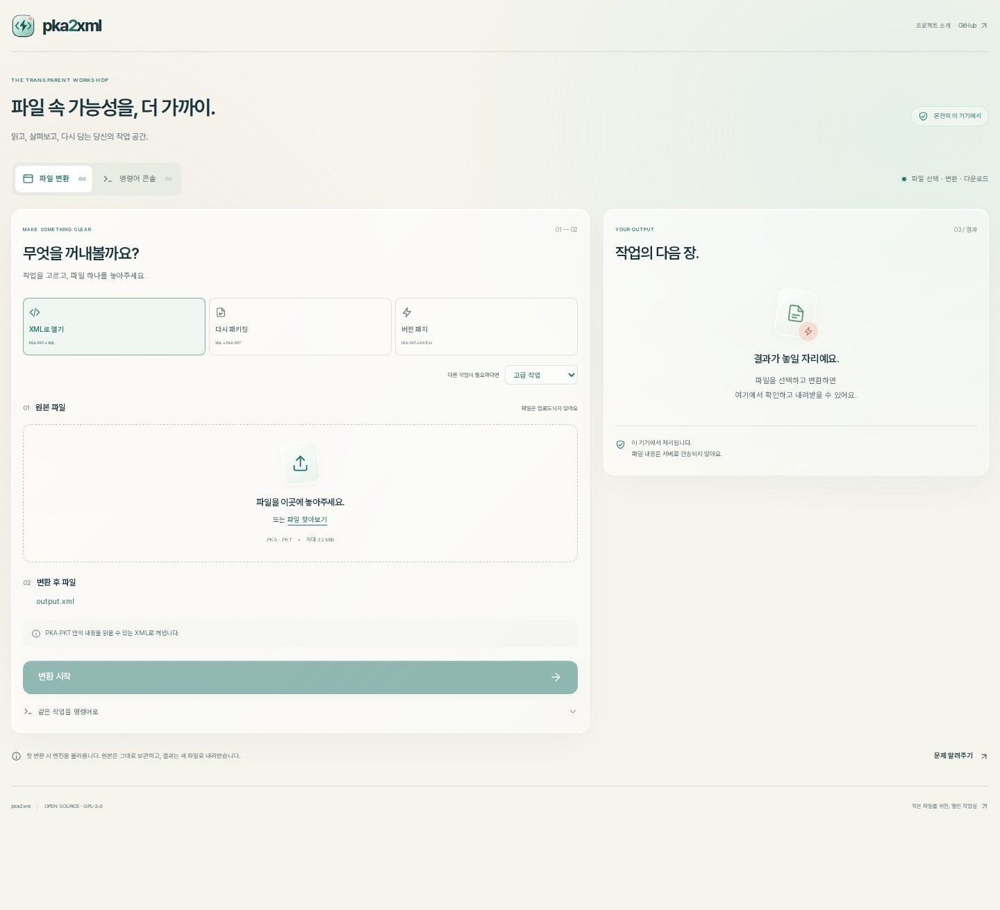

<p align="center">
  
</p>

# pka2xml

**Transparent workshop · 파일 속 네트워크를 펼치는 투명한 작업실**

> **Open the file. Understand the network.**

pka2xml은 Cisco Packet Tracer의 `.pka`·`.pkt` 파일을 XML로 읽고 다시 암호화하는 로컬 도구입니다. CLI, Electron 데스크톱 앱, WebAssembly 브라우저 작업실이 같은 C++ 변환 엔진을 공유합니다. 파일 구조를 살펴보고, 실습 내용을 이해하고, 필요한 작업을 재현할 수 있도록 만듭니다.

**A local toolkit for inspecting and converting Packet Tracer files.** Choose the command line, desktop app, or browser workbench. Conversion runs on your device; the browser does not upload the selected file to a conversion server.

[빠른 시작 / Quick start](#quick-start) · [지원 범위 / Support](#support-and-limits) · [구조 / Architecture](docs/architecture.md) · [기여 / Contributing](CONTRIBUTING.md) · [철학 / Philosophy](PHILOSOPHY.md)



[소개 페이지](docs/screenshots/web-introduction.jpg) · [데스크톱 화면](docs/screenshots/desktop-workbench.jpg) · [모바일 화면](docs/screenshots/web-mobile.jpg) · [실행 검증 기록](docs/verification-2026-10-23.md)

## What you can do

- **읽기와 변환:** Packet Tracer 파일을 XML로 풀고, 수정한 데이터를 다시 암호화합니다.
- **기기에 남는 처리:** 네이티브 실행 파일과 브라우저 워커가 로컬에서 작업합니다. 웹 앱과 엔진 파일을 처음 내려받는 연결은 별도로 필요합니다.
- **실패 이후의 복구:** 잘못된 인자, 손상된 입력, 압축 해제 크기를 검사합니다. 네이티브 변환이 실패하거나 쓰기 도중 중단되어도 기존 출력 파일을 보존합니다.
- **선택 가능한 작업 방식:** 웹 소개 페이지 `/`에서 시작해 `/workbench`로 이동하거나, 데스크톱 파일 대화상자와 CLI를 사용합니다.
- **선택적 토폴로지 내보내기:** 복호화한 XML에서 한글 이름을 보존하는 DOT 그래프를 만들고, Graphviz로 PNG를 생성합니다.

버전 태그 변경은 새 기능을 이전 Packet Tracer에 추가하지 않습니다. 모든 Packet Tracer 버전이나 파일 변형에 대한 호환성을 보장하지 않으며, 확인한 범위는 아래 표와 [검증 안내](docs/native-build.md)에 구분해 두었습니다.

## Quick start

아래 명령은 이 README가 포함된 소스 버전을 기준으로 합니다. 변경 사항을 PR에서 검토 중이면 해당 브랜치를 먼저 선택해 주세요.

### 1. Get the source / 소스 받기

```sh
git clone --depth 1 https://github.com/hslcrb/pka2xml_hslcrb-vendored.git
cd pka2xml_hslcrb-vendored
```

### 2. Native CLI / 네이티브 CLI

검증 환경은 Linux x86-64입니다. C++17/C 컴파일러, GNU Make, Git, Bash가 필요하며 테스트에는 Python 3을 사용합니다. 네이티브 실행 파일은 소스에서 빌드합니다.

```sh
# Retrieve the exact pinned native dependency sources.
git submodule update --init --recursive

# Build locally; this does not install into system directories.
./setup.sh
./run_cli.sh --help

# Try the repository's real fixture.
./run_cli.sh -d "B13_스7회.pka" "example.xml"
./run_cli.sh -e "example.xml" "roundtrip.pka"

# Run native, launcher, and topology regression checks.
make test
```

`./setup.sh`는 Crypto++, RE2, zlib를 고정된 소스에서 빌드하고 현재 소스와 실행 파일을 확인합니다. `run_cli.sh`는 빌드 상태가 없거나 소스·실행 파일이 바뀌었으면 재빌드를 안내합니다. 다른 디렉터리에서 실행해도 입력·출력의 상대 경로는 호출한 위치를 기준으로 유지됩니다.

시스템 개발 패키지를 이미 준비했다면 `./setup.sh --system` 경로도 사용할 수 있습니다. 정적 링크, 설치 대상, sanitizer 실행은 [네이티브 빌드 안내](docs/native-build.md)를 참고하세요. 기본 `make`는 로컬 빌드만 수행합니다.

### 3. Browser workbench / 브라우저 작업실

Node.js 24와 npm 환경에서 웹 빌드를 검증합니다. 저장소에 브라우저용 JS/WASM 엔진이 포함되어 있으므로 웹 앱 실행에 네이티브 컴파일러나 Emscripten이 바로 필요한 것은 아닙니다.

```sh
cd web
npm ci
npm run build
npm run start
```

[http://localhost:3000](http://localhost:3000)에서 소개 페이지를, [http://localhost:3000/workbench](http://localhost:3000/workbench)에서 작업실을 엽니다. 개발 중에는 `npm run dev`를 사용할 수 있습니다.

C++ 엔진을 수정했다면 Emscripten을 준비하고 저장소 루트에서 `./web/build_wasm.sh`로 브라우저 엔진도 다시 빌드해야 합니다. 네이티브와 WASM 의존성 빌드 경로는 분리되어 있습니다. [웹 안내](web/README.md)와 [엔진 산출물 기록](docs/runtime-artifacts.md)을 확인하세요.

### 4. Desktop / 데스크톱

저장소 루트에서 네이티브 엔진을 준비한 뒤 실행합니다.

```sh
./setup.sh
./run_gui.sh
```

데스크톱의 JavaScript 의존성과 운영체제에 맞는 Electron 런타임이 준비되어 있어야 합니다. 필요한 경우 `gui/`에서 프로젝트에 지정된 Yarn 환경으로 `corepack yarn install --immutable`을 실행하세요. 패키지 매니저나 Electron을 처음 준비할 때는 네트워크 연결이 필요할 수 있습니다.

데스크톱 소스 빌드와 패키징은 별도 단계입니다. 검증한 운영체제와 패키징 조건은 [데스크톱 안내](gui/README.md)를 따르세요. 이 저장소는 검증되지 않은 Windows/macOS 설치 파일이나 다운로드 릴리스를 제공한다고 주장하지 않습니다.

## CLI operations

기존 여섯 가지 작업을 유지합니다. 작업은 첫 번째 인자로 지정하고 필요한 경로를 정확히 전달합니다. 공백이나 한글이 포함된 경로는 따옴표로 감싸 주세요.

| Operation | Command | 결과 / Behavior |
| --- | --- | --- |
| Decrypt | `./run_cli.sh -d input.pka output.xml` | 인증된 `.pka`·`.pkt` 입력을 XML로 복호화 |
| Encrypt | `./run_cli.sh -e input.xml output.pka` | XML 데이터를 Packet Tracer 형식으로 암호화 |
| Patch version | `./run_cli.sh -f input.pkt patched.pkt` | 인식한 버전 태그를 변경해 다시 암호화; 실제 호환성은 파일 내용에 따라 달라짐 |
| Read nets | `./run_cli.sh -nets nets` | 기존 `nets` 형식을 복호화해 표준 출력으로 표시 |
| Read logs | `./run_cli.sh -logs packettracer.log` | Base64 로그를 줄 단위로 복호화해 표준 출력으로 표시 |
| Legacy authentication file | `./run_cli.sh --forge legacy.nets` | 기존 호환성 작업을 유지하며 합성 인증 데이터를 출력 파일에 기록; 입력 파일 인자 없음 |

`--help` 또는 `-h`로 도움말을 확인합니다. 종료 코드는 **0: 성공**, **1: 변환·입출력 실패**, **2: 잘못된 인자**입니다. 입력과 출력이 같은 파일 또는 같은 파일을 가리키는 별칭이면 거부합니다. 출력 파일은 완전히 작성한 뒤 교체합니다.

### Optional topology export

```sh
# Python standard library only; useful on a headless machine.
python3 graph.py example.xml --no-render --dot "network map.dot"

# Graphviz 'dot' is required for PNG rendering.
python3 graph.py example.xml
```

기본 출력은 `network.dot`와 `network.png`입니다. `--dot`·`--png`로 경로를 지정할 수 있습니다. 알려지지 않은 포트는 기본 이름으로 처리하며, 장치를 해석할 수 없는 링크는 경고와 함께 건너뜁니다. 활동 파일은 첫 번째 `PACKETTRACER5/NETWORK`를 내보냅니다. 세부 범위는 [토폴로지 안내](docs/native-build.md#optional-topology-export)에 있습니다.

## Support and limits

**Tested behavior is narrower than a universal compatibility promise.** 다음 표는 실행 증거와 아직 검증하지 않은 범위를 구분합니다.

| Area | 확인한 범위 / Verified scope | 제한 / Limits |
| --- | --- | --- |
| Native CLI | Linux x86-64에서 고정 의존성으로 소스 빌드, 실제 `.pka` fixture, 바이너리 왕복, 손상 입력과 출력 보존 검사 | Windows/macOS 네이티브 빌드 미검증; POSIX 파일 처리 사용 |
| Browser engine | Chromium 및 실제 WASM 워커에서 반복 변환, 손상 입력 이후 재시도, 인자·경로 검사 | 다른 브라우저와 모든 모바일 기기까지 검증한 것은 아님 |
| Desktop | Linux x86-64에서 실제 Electron UI·IPC·네이티브 왕복 변환, 오류 복구와 모바일 폭 레이아웃 검사 | 설치형 패키지 배포 검증은 별도 필요; Windows/macOS 미검증 |
| File formats | 실제 `B13_스7회.pka`와 해당 XML의 일치 및 왕복 검사 | 모든 Packet Tracer 버전·`.pkt` 변형을 보장하지 않음 |
| Legacy operations | 합성 데이터로 이전 형식 버전 패치, nets/logs 경로 검사 | 실제 모든 legacy 변형 미검증; script-module 변환 미구현 |
| Topology | 실제 fixture의 6개 장치·5개 링크, 한글·인용부호·누락 필드와 DOT 생성 | Graphviz가 있어야 PNG 생성 가능; 모든 XML 스키마를 지원하지 않음 |

브라우저 입력 파일은 **32 MiB 이하**로 제한하며, 각 워커 요청은 60초를 넘으면 중단합니다. 공유 엔진은 **평문·압축 해제 결과 128 MiB**, 인코딩된 입력 129 MiB까지 허용합니다. 실제 처리 가능 크기는 기기의 사용 가능한 메모리에도 영향을 받습니다.

## Dependencies and offline preparation

`vendor/cryptopp`, `vendor/re2`, `vendor/zlib`, `vendor/libzip`은 **고정 커밋을 가리키는 Git submodule**입니다. 일반 clone이나 최상위 소스 ZIP만으로 이 디렉터리의 내용이 모두 채워지지는 않습니다. 최초 준비에는 `git submodule update --init --recursive`가 필요합니다. 현재 네이티브 변환기는 libzip을 사용하지 않습니다.

완전한 오프라인 환경을 준비하려면 의존성 소스를 채운 체크아웃, 컴파일러·빌드 도구, 필요한 JavaScript 패키지, 운영체제에 맞는 Electron 런타임을 미리 확보해야 합니다. 저장소의 기존 데스크톱 의존성이나 Python wheel이 모든 운영체제·CPU·Python 버전에 맞는다는 뜻은 아닙니다.

브라우저는 정적 앱과 JS/WASM 자산을 먼저 읽어야 합니다. 서비스 워커 기반 오프라인 설치를 제공한다고 주장하지 않습니다. 변환 데이터를 서버로 전송하지 않는 것과, 준비 없이 모든 빌드를 오프라인으로 수행하는 것은 서로 다른 조건입니다.

정확한 소스 리비전은 [의존성 출처](docs/dependencies.md), 브라우저 엔진의 빌드 정보와 해시는 [산출물 기록](docs/runtime-artifacts.md), 타사 라이선스는 [NOTICE](NOTICE.md)에 정리되어 있습니다. 네이티브 실행 파일은 대상 환경에서 `./setup.sh`로 생성하세요.

## Project guide

| 읽을거리 / Guide | 내용 |
| --- | --- |
| [Architecture](docs/architecture.md) | 공유 엔진, 워커, 데스크톱 IPC와 저장소 구성 |
| [Native build](docs/native-build.md) | 빌드, 파일 보존 방식, 테스트와 크기 제한 |
| [Web guide](web/README.md) | 웹 실행 및 브라우저 엔진 준비 |
| [Desktop guide](gui/README.md) | Electron 실행과 패키징 조건 |
| [Philosophy](PHILOSOPHY.md) | 로컬 처리, 배려 있는 실패, 재현 가능한 기술 자립 |
| [Brand](brand/README.md) | 유리 패킷과 스파크 마크, 색상, 표현 원칙 |
| [Contributing](CONTRIBUTING.md) | 작은 변경, 재현 가능한 버그 보고, 검증과 리뷰 |
| [Security](SECURITY.md) | 보안 문제를 전달하는 방법 |
| [Notice](NOTICE.md) | 원저자와 upstream·타사 라이선스 출처 |

## License and authorship

**GNU General Public License v3.0 — GPL-3.0.** [LICENSE](LICENSE)를 확인하고 재배포할 때 기존 저작권 및 타사 라이선스 고지를 유지해 주세요.

Copyright **Rheehose (Rhee Creative), 2008–2026**. 원 프로젝트와 기여자의 저자 표기를 보존하며, upstream 출처와 확인 가능한 범위는 [NOTICE](NOTICE.md)에 기록합니다.

원 프로젝트의 **하나님 중심 가치와 대한민국 기술 자립**이라는 출발점을 존중합니다. 이를 로컬 처리, 이해할 수 있는 코드, 재현 가능한 빌드와 배려 있는 도구로 이어가는 방향은 [프로젝트 철학 / Philosophy](PHILOSOPHY.md)에 담았습니다.

Cisco와 Packet Tracer는 해당 소유자의 명칭입니다. pka2xml은 독립적인 커뮤니티 프로젝트이며 Cisco의 제휴 또는 보증을 의미하지 않습니다.
